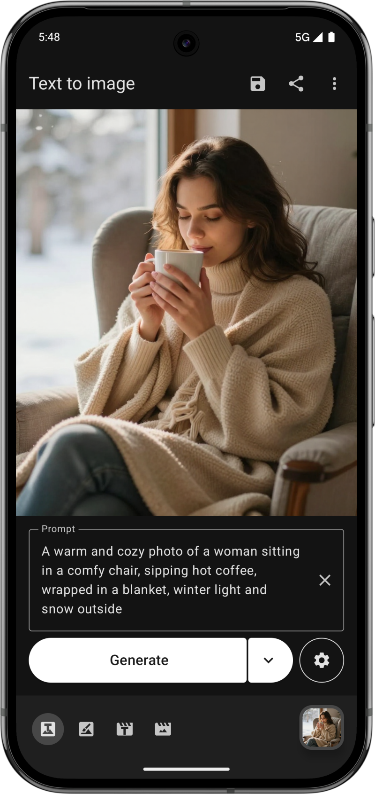
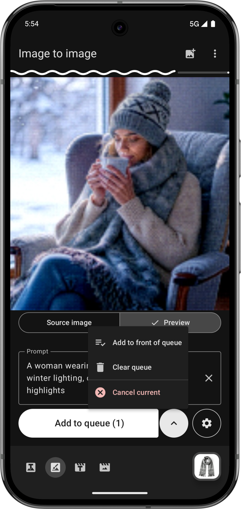
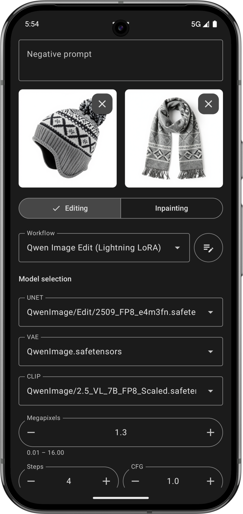
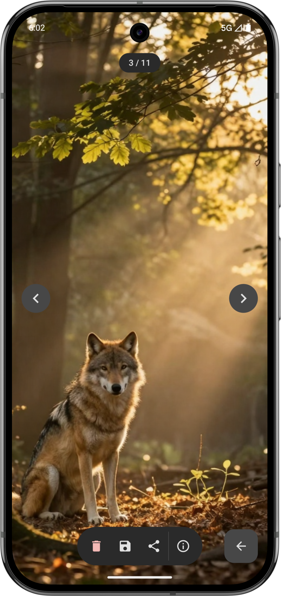
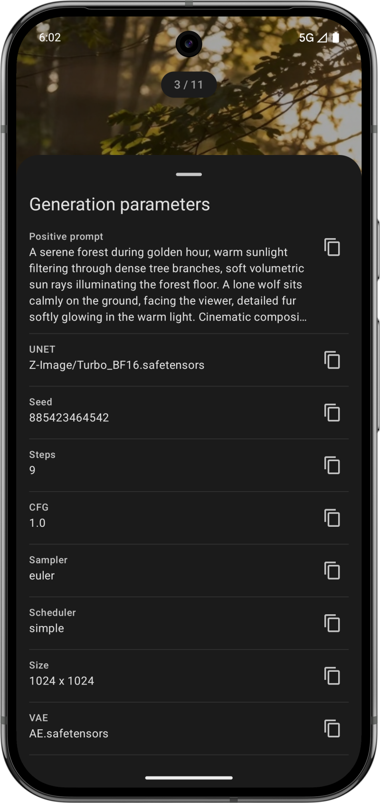
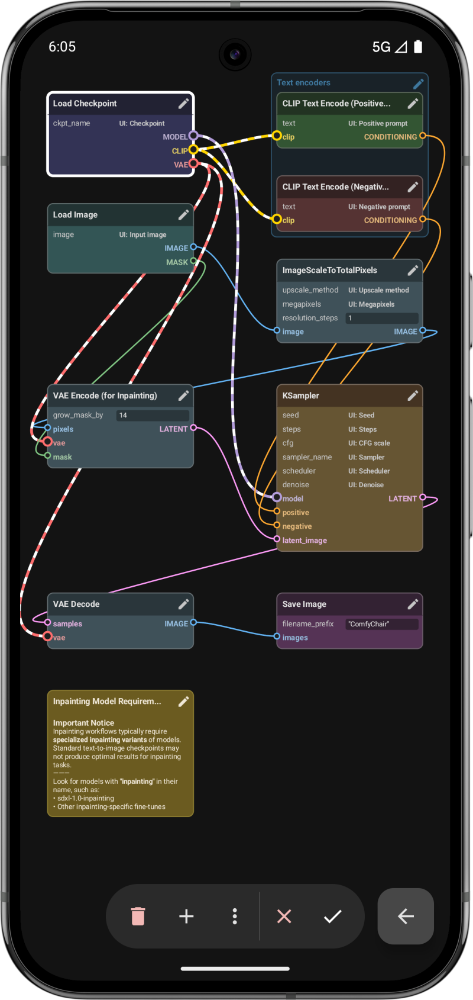
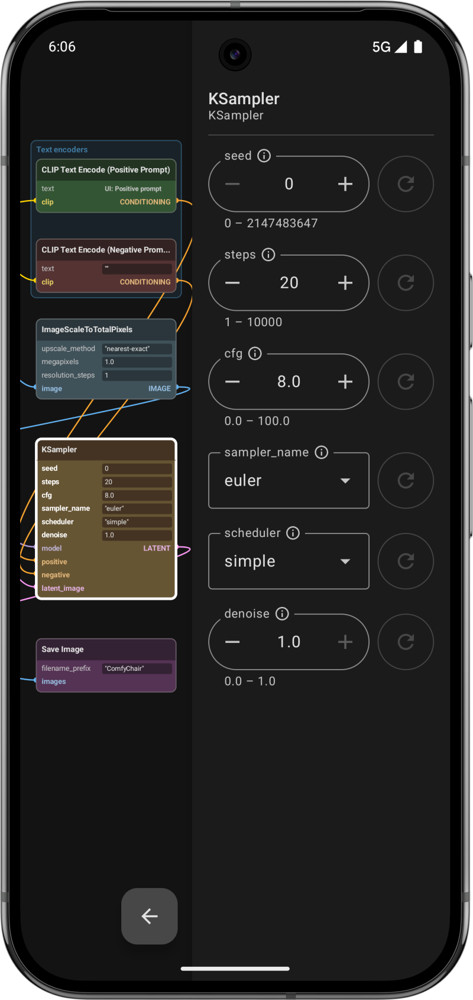

#  ComfyChair Community

An unofficial, native Android UI for [ComfyUI](https://github.com/comfyanonymous/ComfyUI).

**Current version**: v4.24.0（二次开发版 / Community Edition）

> **This project is a fork of [ComfyChair](https://github.com/legal-hkr/comfychair),
> originally developed by Legal HKr, licensed under GPL-3.0.
> All modifications are also licensed under GPL-3.0.**
>
> 本项目是 [ComfyChair](https://github.com/legal-hkr/comfychair) 的二次开发版（GPL-3.0）。
> 原作者为 Legal HKr。原项目的完整开发历史不在本仓库中——本仓库从脱敏后的
> 代码快照开始，源码按 GPL-3.0 同样开源。

## ⚠️ 第三方客户端：不内置任何服务器

- 本应用**不提供、不预置、不代理**任何 ComfyUI 服务器，也不包含任何指向开发者
  个人电脑、内网、代理或云资源的地址。
- 首次启动时服务器地址为空。请自行部署 ComfyUI（或使用你已有的实例），
  然后在 App 里填入**你自己的**服务器地址。
- 内置工作流只是模板，其中的模型名一律留空——请在你自己的服务器上选择模型。

## Overview

A streamlined mobile interface for ComfyUI servers — generate and manage AI images and videos on Android via the ComfyUI API.

**Note**: community-developed project, not officially affiliated with or endorsed by the ComfyUI team.

## Screenshots

       

## Recent changes (v4.23.0 → v4.24.0)

**Added**

- Prompt enhancement is now the only entry for the skill templates: the two template files moved out of the preset-workflow directory into a dedicated one, so generation-page dropdowns no longer list them
- Skill placeholder replacement completed (model + visual-projection fields no longer sent as literals)

**Fixed**

- Skill templates on the generation page no longer 400 (`Value not in list: mmproj`) — all four fields are replaced before submit
- "Auto-select skill failed" gone: the two new fields are registered as recognised, and stale empty-string values fall back to type defaults
- The "(no injection)" option removed from the rule dropdown (it always errored)

Full history: [CHANGELOG](app/src/main/assets/CHANGELOG.md).

## Features

### General

- **Built-in updater**: in-app check, background download via foreground service, SHA-256 verify, tap-to-install; ships empty, can point at any manifest you host
- **3D generation**: Text-to-3D and Image-to-3D with an interactive `.glb` viewer (Filament / SceneView) — orbit, pan, pinch-zoom, and gesture dismissal
- **Danbooru tag library** (full APK): Offline tag database with search, simplified/traditional Chinese normalization, synonym suggestions and co-occurrence recommendations for prompt building
- **Polished visuals**: Ripple + dot-burst effects on buttons, ambient particle overlay, adaptive accent colors (secondary = accent hue +35°), full Material 3 theming with custom color slots
- **Multi-server support**: Save and manage multiple ComfyUI server connections with per-server settings and optional auto-login
- **Server connection**: Connect to remote or local ComfyUI servers with automatic HTTP/HTTPS detection and self-signed certificate support
- **Authentication**: HTTP Basic Auth and API key/Bearer token authentication for servers behind reverse proxies
- **Offline mode**: Browse cached data without network connection, with automatic offline prompt when server is unreachable
- **Queue management**: Submit multiple jobs without waiting, view queue count, cancel current job, add to front of queue, or clear queue entirely
- **Dual workflow support**:
  - **Checkpoint mode**: Traditional CheckpointLoaderSimple workflows
  - **UNET mode**: Modern diffusion workflows (Flux, Z-Image, etc.) with separate UNET, VAE, and CLIP model selection
- **LoRA chain support**:
  - Add up to 5 LoRAs per chain with individual strength control (0.0-2.0)
  - Text to Image and Image to Image: Separate LoRA chains for Checkpoint and UNET modes
  - Text to Video and Image to Video: Separate High Noise and Low Noise LoRA chains
  - LoRAs are dynamically injected into workflows at generation time
- **Prompt Library**:
  - Save prompts as reusable presets with custom names and tags
  - Organize presets with favorites and tag-based filtering
  - Quick access via dropdown or full library dialog
  - Search presets by name, prompt text, or tags
- **Localization**: Available in English (default), German, French, Polish, Spanish, and Chinese with per-app language selection
- **Native Android experience**: Built with Kotlin and Jetpack Compose with Material Design 3

### Generation Modes

- **Text to Image**:
  - Mobile-optimized interface with live progress updates
  - Live preview images during generation (when supported by server)
- **Image to Image**:
  - Two modes: **Editing** (transformation) and **Inpainting** (mask-based)
  - **Editing mode**: Transform images with optional reference images (up to 2)
  - **Inpainting mode**: Mask editor with adjustable brush size and feathered edges
  - Live progress updates and preview images during generation
- **Text to Video**:
  - Generate AI videos with High Noise / Low Noise UNET and LoRA model selection
  - Live preview during generation
- **Image to Video**:
  - Animate still images into videos with adjustable length and frame rate
  - High Noise / Low Noise UNET and LoRA model selection
  - Live preview during generation

### Media

- **Media viewer**:
  - Unified fullscreen viewer for images and videos
  - Material Design 3 Expressive UI with floating toolbar and FAB
  - Swipe navigation between gallery items with tonal navigation buttons
  - Pinch-to-zoom and double-tap to toggle between fit and crop zoom
  - Single-tap to toggle UI visibility (with system bars)
  - Quick actions: delete, save to gallery, share, view metadata
  - Metadata viewer showing generation parameters (prompt, model, seed, steps, etc.)
  - Optimized media caching for smooth transitions between items
- **Gallery**:
  - View all generated images and videos with 2-column grid layout
  - Video indicator on thumbnails
  - Pull-to-refresh to update gallery
  - Multi-select mode with dedicated button or long press to select items
  - Batch operations: save, share, or delete multiple items at once
- **Media management**: Save to device gallery (Pictures/ComfyChair or Movies/ComfyChair) or share

### Workflows

- **Full node graph visualization**: Colored nodes and connections matching ComfyUI's visual style with smooth Bezier curves or Hermite splines
- **Node management**:
  - Add nodes via searchable Node Browser with category filter chips
  - Human-readable display names shown where available (with class type as subtitle)
  - Deprecated and experimental nodes clearly marked with warning/science icons
  - Search by display name, class type, category, or description
  - Long-press output slots to open Node Browser filtered by compatible types
  - Delete, duplicate, bypass, and rename nodes
  - Cleanup tool to remove disconnected nodes
- **Node groups**:
  - Organize nodes into collapsible groups with grid layout
  - Rename groups via context menu
  - Groups persist across saves and theme changes
- **Connection management**:
  - Create connections by tapping an output socket and then an input socket (or vice versa)
  - Target sockets glow when compatible during connection creation
  - Delete connections via node context menu or by selecting and deleting
  - Selected nodes highlight connections with animated flowing segments
  - Connected slot circles enlarge and color-code when highlighted
- **Node attribute editing**:
  - Side sheet editor for node parameters (tap nodes to edit)
  - All editable inputs shown, including those using default values
  - Full support for both legacy and new ComfyUI COMBO input formats
  - Numeric steppers with floating labels, range hints, and increment/decrement buttons
  - Boolean values displayed as on/off toggles
  - Image previews for image selector fields
  - Template values highlighted with "UI:" prefix
  - Connected inputs styled with wire colors
  - Edited values highlighted for easy identification
- **Workflow notes**:
  - Add notes to workflows with Markdown support
  - Unified title and text editor
  - Notes displayed in the workflow graph
- **Navigation and zoom**:
  - Material Design 3 Expressive floating toolbar
  - Zoom controls with percentage display
  - Fit all / Fit width zoom options
  - Initial drawing animation when opening workflows
- **Workflow management**:
  - Create workflows from scratch or import existing ones from ComfyUI
  - Supported formats:
    - ComfyUI LiteGraph (import only) - native ComfyUI workflow format with subgraph support
    - ComfyUI API JSON (import/export) - workflow format used by the ComfyUI API
    - ComfyChair JSON (import/export) - preserves field mappings and app settings
  - Dynamic workflow thumbnails showing mini graph previews
  - Context menus for edit, rename, duplicate, export, and delete
  - Flexible field mapping: only Positive Prompt required (plus source image for image workflows)
  - Dynamic parameter constraints based on workflow node definitions
  - Per-workflow generation settings persistence
  - Workflow Editor returns to view mode after saving for continued editing

### Configuration

- **Server configuration**:
  - View detailed server information (ComfyUI version, OS, Python, PyTorch versions)
  - Monitor hardware resources (RAM and GPU VRAM usage with free/total display)
  - Server management actions (clear queue, clear history)
- **App management**:
  - Clear local cache (generated images, videos, source images, masks)
  - Restore default settings
  - Backup configuration to JSON file (connection settings, workflow values, custom workflows)
  - Restore configuration from backup
- **Workflow management**:
  - View and manage custom workflows with visual thumbnails
  - Upload custom ComfyUI workflows with automatic validation
  - Edit workflow name and description
  - Default generation settings extracted during workflow import
  - Per-workflow generation settings (each workflow remembers its own configuration)
- **Configuration persistence**: Automatically saves and restores all settings including prompts, models, workflow selections, and generation parameters on a per-workflow basis

## 内置工作流（开源版只保留基础模板）

开源版只内置 **4 个最基础**的工作流，覆盖 4 种生成模式：

| 文件 | 名称 | 类型 |
|---|---|---|
| `prebuilt_04_krea2_hires_g1` | 文生图·Krea2 初生图 | 文生图（TTI） |
| `prebuilt_09_krea2_edit_single` | 图生图·单图编辑 | 图生图（ITI Editing） |
| `prebuilt_14_minimaxh3_t2v` | 文生视频·MiniMaxH3 | 文生视频（TTV） |
| `prebuilt_13_minimaxh3_i2v` | 图生视频·MiniMaxH3 | 图生视频（ITV） |

这 4 个模板里的**模型名全部留空**，提示词也为空——不内置任何私有模型路径或示例内容。
首次使用时，请在下拉框里选择**你自己服务器上**的模型。

- 高级工作流（多阶段精修 / SeedVR2·VOSR2 放大 / 技能提示词强化 / 四视图）开源版**不内置**
- 在 ComfyUI 里自行搭建后导出 API 格式，从 App 导入即可使用
- App 功能代码全部保留，任何合规工作流都能导入

### 3D 生成同样支持

- 文生 3D / 图生 3D 的界面、参数面板与 `.glb` 实时预览（Filament / SceneView）**完整保留**
- 开源版只是不内置 3D 工作流模板
- 把你在 ComfyUI 里搭好的 3D 工作流（Pixal3D、IDOL、TRELLIS 等）导出 API 格式导入即可

## 模型介绍数据（开源版为空表）

- `app/src/main/assets/model_intros.json` 开源版为**空表**（`count: 0`）——模型介绍是你服务器上的资产清单
- 用随仓库脚本从你自己的服务器采集，两种来源任选：

```bash
# 扫本地 models 目录（能算 SHA-256，Civitai 命中率最高）
python tools/collect_model_intros.py \
    --models-dir /path/to/ComfyUI/models \
    --out app/src/main/assets/model_intros.json

# 或者只从运行中的服务器拉清单，按文件名反查
python tools/collect_model_intros.py \
    --server http://127.0.0.1:8188 \
    --out app/src/main/assets/model_intros.json
```

- 脚本按 SHA-256 反查 Civitai（含作者/简介/标签），搜不到再按文件名补查 Civitai 与 HuggingFace
- 未命中的会列成清单方便你手工补，详见脚本头部注释

## Requirements

- Android 13 (API level 33) or higher
- Access to a running ComfyUI server instance
- Network connectivity to reach your ComfyUI server
- **仅面向手机**（详见下节「设备适配」）：平板与折叠屏展开态未做适配

## 设备适配（仅手机）

本应用只面向手机（竖屏）；平板、折叠屏展开态等最小宽度 ≥ 600dp 的设备未适配：

- 布局按手机宽度（约 320–430dp）设计，硬编码 dp，未用 `WindowSizeClass`，无响应式/双栏布局
- 所有 Activity 在 `AndroidManifest.xml` 声明 `screenOrientation="portrait"`
- 清单里的 `<supports-screens>` 在 API 13+ **只是声明、不是安装过滤**——平板仍可安装，只是界面未适配
- Android 16（API 36）起，targetSdk ≥ 36 的应用在大屏会被系统忽略竖屏锁定；本应用以
  `PROPERTY_COMPAT_ALLOW_RESTRICTED_RESIZABILITY` 临时 opt-out（官方说明 API 37 起失效）
- 支持平板需单独做响应式适配（`WindowSizeClass` + 去硬编码 dp），是产品决策（方案 B），不在当前范围

## 安全边界（已知残余风险）

强制约束与**尚未全域收口的残余面**统一记录在 [SECURITY.md](SECURITY.md)。重点：

- **明文策略**：平台层仍放行明文（`<domain>` 不支持 CIDR 网段）；「明文只发私网」由
  `NetworkPolicy` + `CleartextGuardInterceptor` 在 OkHttp 层执行
- **WebView 登录页及未走 `ComfyUIClient.secured()` 的链路不在闸门内**（已在 SECURITY.md 声明）
- **分享**：FileProvider 只声明 `cacheDir/share/` 与 `update/`；新增分享必须走 `ShareFileStore`
- **更新**：恢复安装包前复验 sha256 与包名；签名认证由系统安装器在安装时承担

新增网络 / 分享 / 更新代码前请先读 [SECURITY.md](SECURITY.md)。

## Development setup

### Prerequisites

1. **Android Studio** (latest stable version recommended)
2. **JDK 11** or higher
3. **Android SDK** with API level 36

### Building the project

1. Clone the repository:
   ```bash
   git clone https://github.com/<your-account>/ComfyChair-Community.git
   cd ComfyChair-Community
   ```

2. Set up your local environment:
   - Ensure `JAVA_HOME` is set to your JDK installation
   - Configure Android SDK path in `local.properties`

3. Build the app:
   ```bash
   ./gradlew assembleDebug
   ```

4. Run on device/emulator:
   ```bash
   ./gradlew installDebug
   ```

### Running tests

```bash
# Unit tests
./gradlew test

# Instrumented tests (requires device/emulator)
./gradlew connectedAndroidTest
```

## Configuration

To connect to your ComfyUI server, you'll need:
- ComfyUI server URL (e.g., `http(s)://192.168.1.100:8188`)
- Network access between your Android device and the ComfyUI server

## Tech stack

- **Language**: Kotlin 2.0.21
- **Min SDK**: Android 13 (API 33)
- **Target SDK**: Android 15 (API 36)
- **UI Framework**: Jetpack Compose with Material Design 3 (including Expressive components)
- **Video Playback**: Media3 ExoPlayer
- **3D Rendering**: Filament / SceneView (`.glb` preview)
- **Architecture**: MVVM with ViewModels and StateFlow
- **Navigation**: Jetpack Compose Navigation
- **Build system**: Gradle with Kotlin DSL
- **Testing**: 2202 JVM unit tests (pure-logic extraction keeps effects, gestures, download policy, security policy and viewer logic testable without a device)

## Contributing

This project follows standard Android development practices:
- Kotlin coding conventions
- Jetpack Compose best practices
- Material Design 3 guidelines
- MVVM architecture pattern

Issues and pull requests are welcome. For behavioral changes, please include a unit test where the logic can be expressed as a pure function (the codebase deliberately extracts effects/gesture/download logic into testable units).

## License

[GPL-3.0](https://www.gnu.org/licenses/gpl-3.0.en.html)

```
This project is a fork of ComfyChair (https://github.com/legal-hkr/comfychair),
originally developed by Legal HKr, licensed under GPL-3.0.
All modifications are also licensed under GPL-3.0.
```

本项目同样以 GPL-3.0 发布。完整许可证文本见仓库根目录 [LICENSE](LICENSE)。

## 上游同步

本仓库从脱敏快照开始，不包含原项目的提交历史。要拉取上游改动：

```bash
git remote add upstream https://github.com/legal-hkr/comfychair.git
git fetch upstream
git diff upstream/main --stat   # 先看差异，别直接 merge（会带回本仓库已脱敏的内容）
```

⚠️ 合并上游时注意：上游可能重新引入指向个人服务器/域名的配置，
以及本仓库已移除的模型介绍数据与高级工作流，需要重新脱敏。

## Acknowledgments

- [ComfyUI](https://github.com/comfyanonymous/ComfyUI) - The powerful node-based UI this app interfaces with
- [ComfyChair](https://github.com/legal-hkr/comfychair) by Legal HKr - 本项目的上游原作者
- [Claude](https://claude.ai) by Anthropic - AI assistant that provided valuable support during the development process, helping with code implementation, architecture decisions, and documentation
